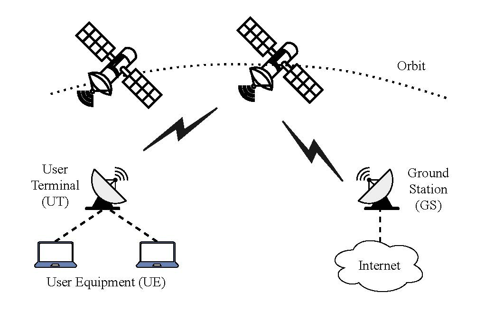

# Tunnel Setup via ARA Wireless Living Lab for Satallite Communication and End-to-End Transport-Layer Performance Measurements
Author: Jie Wang (jiew@iastate.edu)

## Tunnel: User Terminal (UT) → Satellite Link → Ground Station → Internet → Google Cloud Virtual Machine (VM)

- This guide describes how to set up a tunnel from a **User Terminal (UT)** through the **satellite network** to a **Google Cloud VM** using **WireGuard**.
- The goal is to measure **end-to-end latency, throughput, and packet loss** over the satellite link.

<!-- --- -->
## 1. System Overview

<!--  -->
<p align="center">

</p>

## 2. Prerequisites

### 2.1. Local & Remote Access
- SSH access to **UT**: Please check out the ARA user manual [Measuring OneWeb Satellite Link Characteristics](https://arawireless.readthedocs.io/en/latest/ara_experiments/arahaul_experiments/oneweb_basic.html)
- SSH access to **Google Cloud VM**: Create a Google Cloud VM and access it via following


    #### Access Google Cloud VM via **gcloud CLI**

    #### Step 1: Download Google Cloud SDK and make sure you're authenticated and targeting the correct project and zone.

    If you haven’t already, log in:

    ```bash
    gcloud auth login
    ```

    #### Step 2: Set Your Project and Compute Zone
    ```bash
    gcloud config set project <your-project-id>
    gcloud config set compute/zone <compute-zone>
    ```

    #### Step 3: Connect to the VM
    ```bash
    gcloud compute ssh <vm-instance-name>
    ```

### 2.2. Software Requirements
- **WireGuard** installed on both UT and Google VM:
  ```bash
  sudo apt update && sudo apt install wireguard tcpdump 
  ```
- **WireGuard** verification:
  ```bash
  wg --version
  ```

### 2.3. Google Cloud Firewall Rules

- Option #1: Google Cloud Console (Web UI)

    In **VPC → Firewall**, create an ingress rule to allow WireGuard:

    - **Name:** `allow-wireguard`
    - **Direction:** Ingress
    - **Targets:** Your VM instance (or use a target tag)
    - **Source IP ranges:** `0.0.0.0/0` *(or restrict to the UT’s public IP for better security)*
    - **Protocols & ports:** `UDP:51820`

- Option #2: Google Cloud CLI

    You can achieve the same rule using the `gcloud` CLI:

    ```bash
    gcloud compute firewall-rules create allow-wireguard \
        --direction=INGRESS \
        --priority=1000 \
        --network=default \
        --action=ALLOW \
        --rules=udp:51820 \
        --source-ranges=0.0.0.0/0 \
        --description="Allow WireGuard UDP traffic on port 51820"
    ```
- Option #3: Firewall rule verification
    ```bash
    gcloud compute firewall-rules list --format=table(name,direction,network,priority,sourceRanges,allowed,targetTags)
    ```

## 3. WireGuard Configuration

### 3.1. Commands to Generate Public and Private Keys
Run the following on each machine (VM and UT):
```bash
# Generate private key
sudo mkdir -p /etc/wireguard && cd /etc/wireguard
wg genkey | tee private.key | wg pubkey > public.key

# Move them to /etc/wireguard/ for better organization and permissions
sudo mv private.key /etc/wireguard/
sudo mv public.key /etc/wireguard/
sudo chmod 600 /etc/wireguard/private.key
```

### 3.2 VM Side 
Create a configuration file via `sudo nano /etc/wireguard/wg0.conf`
```ini
[Interface]
PrivateKey = <VM_PRIVATE_KEY>
Address = 10.77.0.1/32
ListenPort = 51820

[Peer]
PublicKey = <UT_PUBLIC_KEY>
AllowedIPs = 10.77.0.2/32
PersistentKeepalive = 25
```

### 3.3. UT Side 
Create a configuration file via `sudo nano /etc/wireguard/wg0.conf`
```ini
[Interface]
PrivateKey = <UT_PRIVATE_KEY>
Address = 10.77.0.2/32
ListenPort = 50400

[Peer]
PublicKey = <VM_PUBLIC_KEY>
Endpoint = <VM_PUBLIC_IP>:51820
AllowedIPs = 10.77.0.1/32
PersistentKeepalive = 25
```
**Important Notes**:
- Do not set AllowedIPs = 0.0.0.0/0 unless you have proper routing exceptions; it can break SSH access.
- Both configs must use matching public/private keys.

### 3.4 Bind WireGuard to the UT’s satellite interface IP
#### 1. Identify the satellite gateway (if the gateway is known, please skip this subsection.)
- If you are not aware of the satellite gateway IP or want to verify, 
    ```bash
    ip route show
    ```
- Ping a public IP via an interface enoxxx. If it is the satellite gateway, one can see higher latency, e.g., 50-100ms, and its traces can be used for verification.
    ```bash
    ping -I enoxxx 8.8.8.8
    traceroute -i enoxxx 8.8.8.8
    ```
    Look for:

    * Hop 1 = satellite gateway
    * Several 10.x.x.x or private hops before reaching public internet — these are inside the satellite network.
    * Sudden latency jump after a few hops (indicates space segment)

#### 2. Add satellite gateway to ensure the satellite route
- On the UT, add a host-specific route so the Google VM’s public IP uses the satellite NIC (e.g., eno12429) and gateway (e.g., 192.168.42.1):
    ```bash
    sudo ip route add <GOOGLE_VM_PUBLIC_IP>/32 via <gateway> dev eno12429
    ```

## 4. Starting the Tunnel and Verification
### 4.1 Bring Up the WireGuard VPN Interface 
On both the UT and Google VM, run
```bash
sudo wg-quick up wg0
sudo wg-quick down wg0 2>/dev/null; sudo wg-quick up wg0 # if wg0 was started before
```

### 4.2 Handshake Verification
On both the UT and Google VM, run
```bash
sudo wg show
```
- It shows the public key, listening port, and whether handshake is established.
- If the `latest handshake` is not shown, the tunnel is not established; check the firewall rule, endpoint IP, listening port, and public/private key matching.

### 4.3 Ping Test
- From UT
    ```bash
    ping -c 5 10.77.0.1
    ```
- From VM
    ```bash
    ping -c 5 10.77.0.2
    ```
Successful ping test would show soemthing like `5 packets transmitted, 5 received, 0% packet loss, time 4005ms`.

### 4.4 Packet Capture with tcpdump

- From VM
    ```bash
    sudo tcpdump -ni any udp port 51820
    ```

- From UT (optional)
    ```bash
    sudo tcpdump -i eno12429 udp port 51820
    ```
Successful tcpdump test would show inbound and outbound UDP packets between source, i.e., UT’s public IP and source port, and destination, i.e., VM’s public IP and port 51820.

## 5. Automated Tunnel Setup Script on the UT
A bash script [`sat_tunnel_setup.sh`](sat_tunnel_setup_final.sh) is created to automate the WireGuard tunnel bring-up on the UT.

### Purpose
This script **automates all the basic tunnel bring-up steps** so you do not have to:
- Manually run `wg-quick up wg0`
- Manually check `wg show` to see if the handshake worked
- Manually ping the VM’s tunnel IP to confirm connectivity
- Manually stop the Wireguard interface and/or remove the VM public IP route
- Manually monitor the tunnel status, e.g., whether handshake is successul

### 5.1 Script Transfer to the UT
```bash
scp "path/to/script" username@ip_address: (Windows)
scp /mnt/c/Users/xxx/script username@ip_address: (Windows WSL)
```

### 5.2 Start the Tunnel
1. Make it executable
    ```bash
    chmod +x /home/username/sat_tunnel_setup.sh
    ```
2. Run the script
    ```bash
    ./sat_tunnel_setup.sh start
    ```

3. (Optional) If a "bad interpreter" issue shows up, it is because the file has Windows-style line endings (CRLF) instead of Unix-style (LF). Fix it via:
    ```bash
    sed -i 's/\r$//' sat_tunnel_setup_v2.sh
    ```

4. Stop the satellite WireGuard tunnel and removes all related routes/rules
    ```bash
    ./sat_tunnel_setup.sh stop
    ```

5. (Optional) Shows the current satellite tunnel routing and marking state
    ```bash
    ./sat_tunnel_setup.sh status
    ```